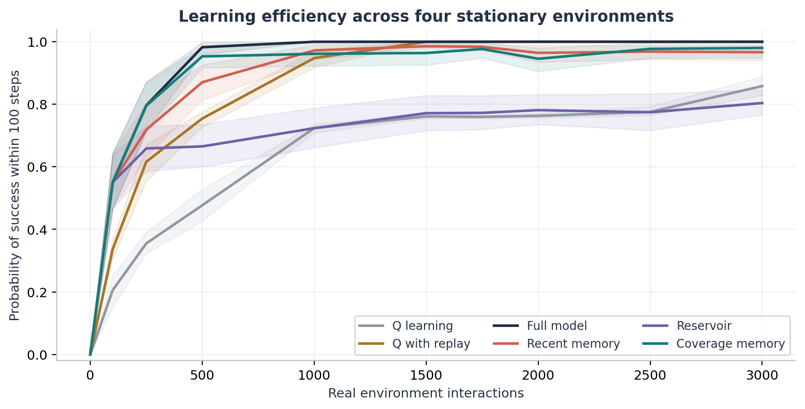
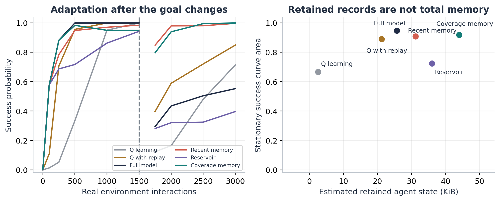
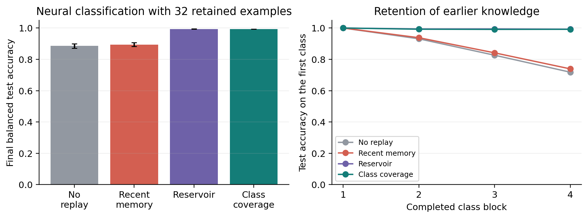

<p align="center"></p>

# Efficient Agents: Memory Selection and Planning Budgets

**Research by SID Machines**

How much experience should an agent retain, and how much computation should it spend reusing that experience? This project investigates that question through controlled reinforcement-learning simulations and a small neural continual-learning experiment.

The expanded study contains **2,100 seeded control-agent runs**, **140 neural-classifier runs**, and **6.3 million simulator interactions**. Its central finding is that efficiency depends on the task: recent memory helps an agent adapt to a changed objective, diverse memory helps preserve earlier classes, and a smaller experience buffer does not automatically reduce total storage or computation.

This empirical research record extends the original gridworld project. The contribution is a reproducible comparison of memory and planning choices, including failure cases and uncertainty estimates. It does not introduce a new reinforcement-learning algorithm or establish results on deployed LLMs.

## Start here

| Resource | What it contains |
|---|---|
| [Research paper](research/01_Paper/Research_Paper.pdf) | Nine pages of research plus the SID Machines cover |
| [Technical supplement](research/01_Paper/Technical_Supplement.pdf) | Methods, data dictionary, reproduction, and proposed LLM validation |
| [Research guide](docs/RESEARCH_GUIDE.md) | Questions, experimental design, evidence, and interpretation |
| [Reproduction guide](docs/REPRODUCING.md) | Installation, verification, analysis, and rerun instructions |
| [Research package contents](research/00_START_HERE.html) | Offline navigation after downloading the repository |
| [Change record](CHANGELOG.md) | How the expanded investigation develops the original project |
| [Original paper](research/06_Original_Project/sid-efficient-agents-main/PAPER.md) | Preserved historical write-up |

The PDFs and figures are available directly on GitHub. Download the repository and open the HTML files locally for the offline contents page and editable reports. Research documents retain the private-circulation wording of the prepared report copies; their inclusion here is the owner's authorized public release of this archive.

## Research questions

1. Can planning with a learned transition model improve learning under a fixed interaction budget?
2. Which experiences should bounded memory retain: recent transitions, a sample of history, or transitions covering different state-action pairs?
3. How does the answer change when the objective changes?
4. Does planning depth matter independently of the total number of value updates?
5. Do related retention effects appear in a small neural continual-learning task?

## Experimental scope

| Component | Design |
|---|---|
| Control environments | Small grid, larger grid, noisy grid, changed-goal grid, finite-state tool workflow |
| Baselines | Q learning, Q learning with replay, full-history learned model |
| Bounded model memory | Recent/FIFO, reservoir sampling, state-action coverage |
| Raw transition capacities | 32, 64, 128, 256 |
| Repetitions | 20 training seeds per configuration |
| Interaction budget | 3,000 real simulator interactions per control run |
| Main matrix | 1,500 runs |
| Planning ablations | 600 additional runs |
| Evaluation | Exact 100-step greedy policy evaluation at 10 checkpoints |
| Neural extension | 140 runs of a 228-parameter classifier on four sequential synthetic classes |
| Uncertainty | Bootstrap intervals; primary contrast paired by seed across four fixed stationary tasks |

The 2,240 total runs are repetitions across configurations, not 2,240 distinct architectures or language models. Learning does not receive the evaluator's transition kernel. The tool workflow simulates prerequisites and retries, with no real external tool or language-model calls.

## Main results

The table averages four stationary tasks equally. Bounded methods and Q replay use capacity 128. The main metric is normalized area under success versus interactions: higher values indicate better success during learning. It is not final accuracy.

| Method | Success-curve area | 95% bootstrap interval | Final success | Retained agent state |
|---|---:|---:|---:|---:|
| Q learning | 0.667 | [0.658, 0.677] | 85.8% | 2.5 KiB |
| Q with replay | 0.891 | [0.884, 0.897] | 100.0% | 21.2 KiB |
| Full learned model | 0.949 | [0.940, 0.957] | 100.0% | 25.7 KiB |
| Recent memory | 0.909 | [0.893, 0.925] | 96.7% | 31.2 KiB |
| Reservoir memory | 0.725 | [0.678, 0.779] | 80.4% | 36.0 KiB |
| Coverage memory | 0.920 | [0.896, 0.940] | 98.0% | 44.0 KiB |

Source: [main findings](research/03_Results/findings.json). State estimates include retained Python bookkeeping and the documented array-base correction, but exclude temporary allocations and full process memory.

**The primary comparison is inconclusive.** Coverage minus recent memory has a success-curve-area difference of **0.01059**, with a 95% interval of **[-0.00946, 0.02897]**. This does not establish an average advantage for coverage memory in the tested stationary setting.



### When forgetting helps

In the changed-goal environment, recent memory achieves a post-change success area of **0.971**, compared with **0.472** for the full-history model. These exploratory results use post-change checkpoints from interactions 1,750 to 3,000. Old reward observations can impede adaptation when the objective changes.

The full model aggregates transition statistics rather than storing every raw record. Its retained state can consequently be smaller than a bounded buffer with Python bookkeeping. Buffer capacity alone is an inadequate efficiency measure.



### Planning depth matters

With the same average total of 30,000 scalar action-value backups, coverage memory achieves stationary success area **0.880** with 20 planning sweeps every 200 interactions, versus **0.695** with five sweeps every 50 interactions. Equal update counts do not make schedules equivalent; CPU timings remain descriptive and implementation-dependent.

### Preserving earlier knowledge in a small neural model

On sequential synthetic classification, final balanced accuracy is **88.6%** without replay, **89.4%** with recent memory of 32 examples, **99.4%** with reservoir memory of 32, and **99.3%** with class-coverage memory of 32. The class-coverage-minus-recent contrast is **9.90 percentage points**, with a 95% interval of **[8.72, 11.10]**.

Replay processes **7,996 training examples** per run versus **1,600** without replay, while all conditions use 1,600 gradient updates. The retention gain must therefore be considered alongside additional work. This experiment uses one small architecture and a fixed synthetic test set.



## Reproduce and inspect

Use Python 3.12 or later in an isolated environment. From the repository root:

```bash
python -m pip install -r research/02_Experiments/requirements.txt
python tools/verify_archive.py
cd research/02_Experiments
python -m unittest test_study.py -v
python verify_results.py
```

These commands check saved evidence without rerunning training. The verifier checks all 2,100 control runs, 140 neural runs, checkpoint counts, source/protocol hashes, resource accounting, and the primary effect. See [REPRODUCING.md](docs/REPRODUCING.md) before regenerating data: training scripts overwrite their outputs.

## Repository organization

```text
README.md                  Research overview and results
PAPER.md                   Entry point to expanded and historical reports
CHANGELOG.md               Research evolution
docs/                      Research guide, reproduction, and future work
tools/verify_archive.py     Read-only SHA-256 verification
research/
  00_START_HERE.html        Offline contents page
  01_Paper/                PDF and editable HTML reports, logo, branding
  02_Experiments/          Training, analysis, tests, protocols, dependencies
  03_Results/              Raw checkpoints, summaries, findings, metadata
  04_Figures/              Five figure sets in PNG and vector PDF
  05_Research_Notes/        References, provenance, analysis decisions
  06_Original_Project/     Unchanged copy of the original project
  MANIFEST_SHA256.txt       Research-file integrity manifest
agents/, gridworld/,       Original implementation, retained at the root
experiments/, results/
```

## Relevance to LLM agents

The proposed application is bounded experience memory around a frozen language model: retain useful tool outcomes, retrieve limited evidence, and account for retrieval and inference costs. The report specifies a possible local evaluation with held-out tasks, matched prompts, token budgets, changed tool versions, and paired success comparisons.

**No LLM benchmark has been run.** The results do not demonstrate reduced pretraining data, GPU cost, energy use, hallucination, or production failures. They motivate hypotheses for a separate study. See [future work](docs/FUTURE_WORK.md) and the technical supplement.

## Limits and research status

- Small, fully observed control tasks and synthetic neural data limit generalization.
- Memory-group definitions are straightforward here; practical agents need an evaluated abstraction or retrieval method.
- Environments are fixed. Intervals describe training-seed variation, not variation across all possible tasks.
- Secondary comparisons are exploratory. The primary null-compatible result is retained.
- The protocol was recorded before the main run, but was not publicly preregistered. Analysis refinements are documented.
- This is a completed local research report, not a peer-reviewed publication.

The bibliography and source roles are in [references.json](research/05_Research_Notes/references.json). [Provenance](research/05_Research_Notes/provenance.txt) distinguishes the original project from the expanded study. No open-source license has been added by this update.
